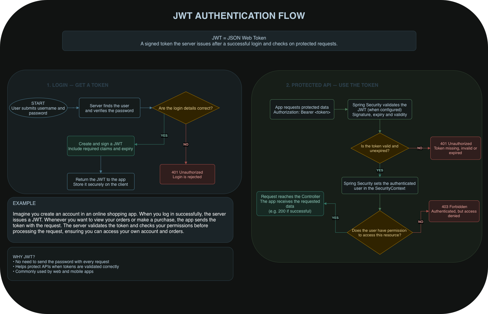

# JWT Authentication Flow

A simple visual guide explaining how **JSON Web Token (JWT)** works, from user login to accessing protected APIs.

## 🔗 Interactive Diagram

[**Open the JWT Authentication Flow Diagram in draw.io**](https://app.diagrams.net/#Wb!ghqVtJCFdUytTwzFTOtAvHn9YWtwsE9PryY9Rw-R7BCR_2gLxyziR4iKEo-uIlLN%2F01FW2NZY2P2JJYSYDQMNAKAGBLQP3V7A57#%7B%22pageId%22%3A%22NrvJatMGmpTUp3HjqgCJ%22%7D)

## 🖼️ Diagram Preview
-->

## 🔍 How JWT Works

1. **Login:** The user submits their username and password.
2. **Verify Credentials:** The server checks the user's login details.
3. **Issue Token:** If the credentials are correct, the server creates and signs a JWT with an expiration time.
4. **Send Token:** The client sends the token with requests to protected APIs, usually using `Authorization: Bearer <token>`.
5. **Validate Token:** The server validates the token's signature and expiration.
6. **Check Permissions:** The server checks whether the authenticated user is allowed to access the requested resource.

If the token is missing or invalid, the server typically returns `401 Unauthorized`. If the user is authenticated but lacks permission, it typically returns `403 Forbidden`.

## 🔐 Security Notes

- JWT is usually signed, not encrypted. Its payload may be readable.
- Never include passwords or secrets in the token payload.
- Tokens should be stored and transmitted securely.
- JWT validation and authorization must be properly configured.

## ⚖️ JWT vs. Session-Based Authentication

**JWT:** The server issues a signed token that the client sends with protected requests. In a typical stateless JWT setup, the server does not need to store a session for every user.

**Session:** The server stores session information and gives the client a session ID, usually in a cookie. The server uses that ID to look up the session.

**Main difference:** A session relies on server-side session storage, while a typical stateless JWT setup carries signed claims in the token itself.

## 🛠️ Tools

- [draw.io / diagrams.net](https://app.diagrams.net/)
- JSON Web Token (JWT)
- Spring Security (for applications configured to use it)

